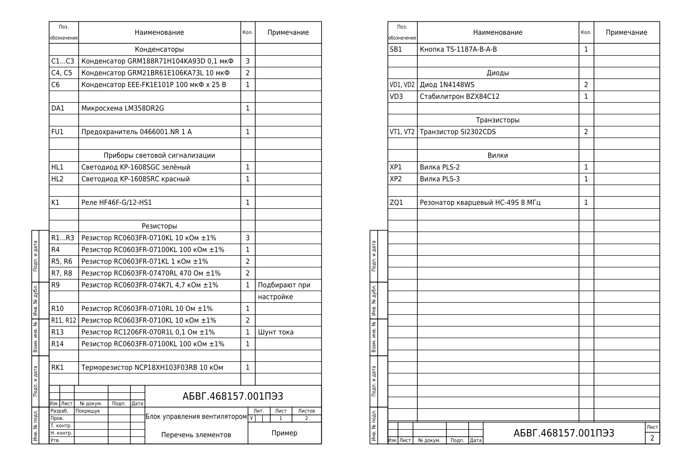

# ESKD Parts List Generator

[](https://github.com/Ethereall-Pluto/eskd-bom/actions/workflows/ci.yml)

Turns an AutoCAD schematic into a finished **parts list (перечень элементов, ПЭ3)** drawn to the
Russian/Ukrainian ESKD standards, and back: reads the components out of a DXF drawing into CSV or Excel.

Writing a parts list by hand means copying every designator from the schematic, merging R1, R2, R3
into "R1...R3", grouping by element type and redrawing the table when a sheet runs out. This tool
does it from the drawing itself, so the list always matches the schematic.

**Stack:** Python, ezdxf, openpyxl, matplotlib, pytest, GitHub Actions.



## What it does

```
schematic.dxf ──► extract ──► components.csv / .xlsx ──► generate ──► parts_list.dxf (+ .png preview)
       └──────────────────────────── build ────────────────────────────────┘
```

- **Reads the schematic.** Every element drawn as a block with `REF`, `NAME` and `NOTE` attributes becomes a component. Tag names in other languages and templates (`DESIGNATOR`, `VALUE`, `ПОЗ`, `НАИМ`…) are recognised; blocks without a designator (frames, logos) are skipped and reported.
- **Applies the ESKD rules** (GOST 2.701, 2.710):
  - sorts by letter code, then numerically (R2 before R10);
  - merges neighbouring identical elements: two become "C1, C2", three or more become "R1...R3";
  - a gap in numbering or a different note starts a new row;
  - writes a group heading ("Резисторы", "Конденсаторы"…) when a group has more than one element, with a blank row between groups;
  - wraps long names and notes onto continuation rows.
- **Draws the sheets** (GOST 2.104, 2.301):
  - A4 frame with 20 mm binding margin, additional graphs 19-23 on it;
  - table 20 / 110 / 10 / 45 mm, 15 mm header, 8 mm rows;
  - title block form 2 (185 × 40) on the first sheet, form 2a (185 × 15) on the rest, 29 and 32 rows;
  - a group heading never ends a sheet: it moves to the next sheet with its group;
  - text that is too wide for its cell is compressed horizontally, as drafters do in AutoCAD.

## Usage

```bash
pip install -r requirements.txt

# schematic -> Excel, to check or edit the list
python -m eskd_bom extract schematic.dxf -o components.xlsx

# list -> parts list drawing
python -m eskd_bom generate components.csv -o parts_list.dxf \
  --code "АБВГ.468157.001ПЭ3" --title "Блок управления вентилятором" \
  --organization "ФКІСІТ" --developer "Покрищук" --litera "У" --preview parts_list.png

# both steps at once
python -m eskd_bom build schematic.dxf -o parts_list.dxf --code "..." --title "..."
```

A ready example is in [`examples/`](examples): `make_sample_schematic.py` draws a 35-element schematic,
and the generated files are next to it.

## Structure

| Module | Responsibility |
|---|---|
| `models.py` | `Component`, `Row`, `TitleBlock`. A component validates its designator on creation (`R1`, `VD12`; Latin capitals per GOST 2.710). |
| `rules.py` | The ESKD logic as pure functions: grouping, ranges, wrapping, pagination. No files, no drawing. |
| `reader.py` | Reads block references and their attributes from a DXF. |
| `tables.py` | CSV and Excel import/export. |
| `drawing.py` | Draws frame, table and title blocks into DXF. Knows geometry, not rules. |
| `preview.py` | Renders the DXF to PNG to check a sheet without AutoCAD. |

Design decisions:

- **Rules apart from drawing.** "R1, R2, R3 is one row" is tested on plain lists in milliseconds; geometry is tested by reading the generated DXF back.
- **Fail fast.** A duplicate designator, a block with a designator but no name, or a malformed designator stops the run with a message naming the element, instead of producing a wrong document.
- **Text is measured, not guessed.** Cell fitting uses real font metrics from ezdxf.

Limitations: graph 1 names are written as given (no automatic shortening under group headings);
the change-record area of the title block is drawn empty. Forms follow GOST 2.104 form 2 / 2a;
check them against your organisation's template before release.

## Tests

```bash
pip install -r requirements-dev.txt
pytest
```

GitHub Actions runs the tests on Python 3.10 and 3.12, builds the sample parts list end to end
and attaches the DXF and PNG to the run.
